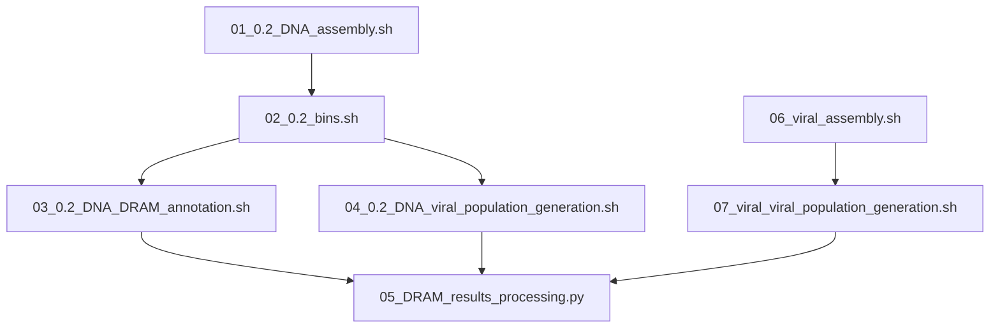

# Viral population identification from the microbial cellular and viral fractions in the PRE hypoxic zone metagenomes

This repository contains the PBS and Python scripts used to assemble, annotate and identify viral populations from the hypoxic zone in the Pearl River Estuary (PRE). Since the study focuses on viral auxiliary metabolic genes (AMGs), the pipeline explicitly identifies and removes viral contamination from the cellular microbial fraction (`0.2 µm`) prior to comparative metabolic analyses.

The results of this work are published in:
> Sun M, Lei Z, Li B, Gao S-H and Fan L (2026) Virus-encoded metabolism may support environmental stress adaptation of microbial hosts in an estuarine hypoxic zone. Frontiers in Microbiology 17:1785655. doi: [10.3389/fmicb.2026.1785655](https://doi.org/10.3389/fmicb.2026.1785655)

## Usage
These scripts were originally run on a HPC cluster using the PBS Pro job scheduler and are provided as an archival reference for the published workflow. Filepaths may need to be adapted to match your local system before running.

### Core software dependencies
- Assembly & Polishing: Unicycler, MetaSPAdes, BWA, SAMtools, Pilon

- Binning & Dereplication: MetaWRAP, dRep

- Annotation & Taxonomy: Prodigal, HMMER, GTDB-Tk, DRAM

- Viral Identification & Clustering: VirSorter2, DeepVirFinder, CheckV

- Data Processing: Python 3 (pandas), SeqKit

```text
├── README.md               # Pipeline documentation and usage instructions
└── scripts/
    ├── 01_pbs_0.2_DNA_assembly.sh  # Hybrid assembly and polishing of microbial cellular fraction (Unicycler,BWA,SAMtools,Pilon)
    ├── 02_pbs_0.2_bins.sh  # Binning and dereplication (MetaWRAP, dRep)
    ├── 03_pbs_0.2_DNA_DRAM_annotation.sh   # Annotation and classification (Prodigal, HMMER, GTDB-Tk, DRAM)
    ├── 04_pbs_0.2_DNA_viral_population_generation.sh   # Identification of viral populations from microbial fraction (VirSorter2, DeepVirFinder, CheckV)
    ├── 05_DRAM_results_processing.py   # Remove viral contamination from microbial fraction (pandas)
    ├── 06_pbs_viral_assembly.sh    # Assembly of viral fraction (MetaSPAdes)
    └── 07_pbs_viral_viral_population_generation.sh # Identification of viral populations from viral fraction (Virsorter2, DeepVirFinder, CheckV)
```


## Data availability
- Raw Sequencing Reads: Deposited in the NCBI Sequence Read Archive (SRA) under BioProject PRJNA1243077.

- Microbial metagenome-assembled genomes (MAGs): Deposited on Figshare under the project "Microbiome of the Pearl River Estuary summer hypoxic zone" (DOI: 10.6084/m9.figshare.28740248 | [Direct Link](https://figshare.com/s/72c9758d779f745bc5e4)).

- Viral Populations: Deposited on Figshare under the same project (DOI: 10.6084/m9.figshare.28740188 | [Direct Link](https://figshare.com/s/413254d138c78265cec4)).
